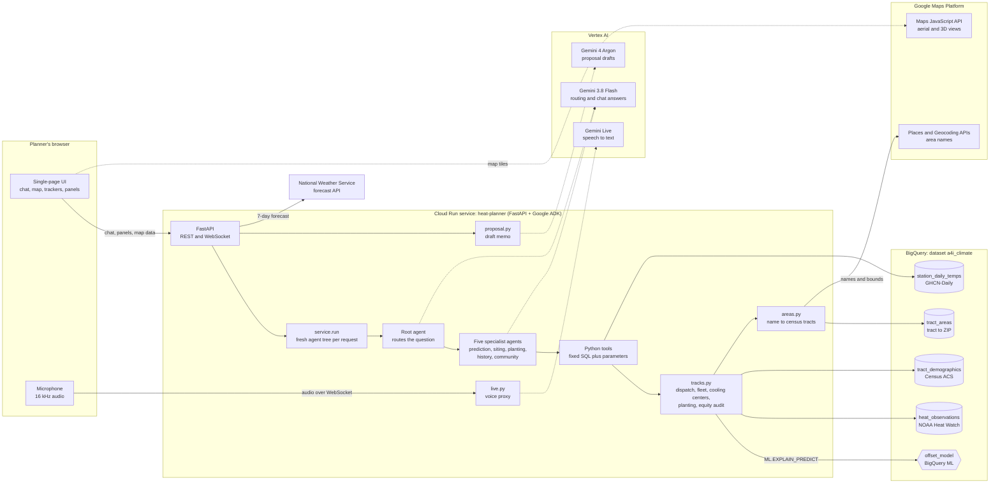
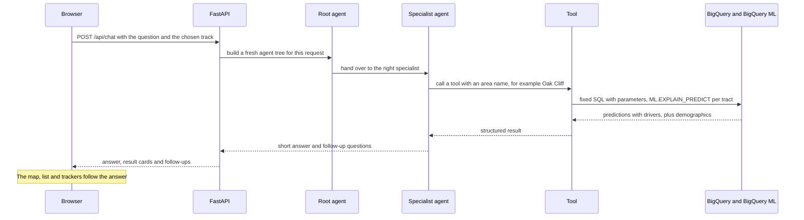

# Heat Compass: urban heat planning for Dallas

**Agents for Impact 2026 · Challenge 1: Community Climate Resilience (Urban Heat)**

Heat Compass is a planning assistant for a city's heat response. A planner asks about a neighbourhood by name ("Oak Cliff", "75215"),
by speaking or typing, and gets a ranked, explained answer for one of three real decisions: where to send help today, where to fund
cooling centers this budget cycle, and where to start planting trees this decade. Every number comes from public data in BigQuery and a
BigQuery ML model; the language model routes questions and writes short answers but never invents figures or writes SQL.

> The original challenge brief from the organisers is kept unchanged in [`instructions_README.md`](instructions_README.md).
> Engineering notes for the agent code are in [`agent/README.md`](agent/README.md).

**Live demo** (lab project, may be taken down after the event): <https://heat-planner-71387418964.us-east1.run.app>

## Contents

1. [The challenge](#1-the-challenge)
2. [The problems we solve, by track](#2-the-problems-we-solve-by-track)
3. [How we solve it](#3-how-we-solve-it)
4. [Architecture](#4-architecture)
5. [Google Cloud products used](#5-google-cloud-products-used)
6. [Data](#6-data)
7. [The model](#7-the-model)
8. [What the app does](#8-what-the-app-does)
9. [Rigor, equity and safety](#9-rigor-equity-and-safety)
10. [Limitations and next steps](#10-limitations-and-next-steps)
11. [Repository layout](#11-repository-layout)
12. [Run, test and deploy](#12-run-test-and-deploy)
13. [API reference](#13-api-reference)
14. [Credits and licence](#14-credits-and-licence)

---

## 1. The challenge

Heat is the deadliest weather in the United States, and it is the most unequal: two blocks in the same city, at the same hour, can differ
by more than fifteen degrees. One has tree cover and low buildings; the other is parking lot. Cities know this in general but rarely have a
number for *this intersection*, an argument they can put in front of a council, or something to ask when the question changes at 4 pm on a
Thursday.

The challenge asks each team to build **a planning assistant for one city's heat response** that:

- answers for places nobody ever measured, by **calling a prediction model**, not by describing historical rows;
- explains *why* a place is hot, because the explanation is what turns a number into an argument;
- serves one of three decisions (the **tracks**), on three different time horizons;
- is built with **Google ADK in Python**, Gemini, BigQuery, at least one tool the team designed, and **BigQuery ML** as the required
  differentiator, and is **deployed on Google Cloud**;
- handles data honestly: licences, validation, bias (race is kept out of the model and the *outcome* is audited), and clear statements of
  what the model cannot do.

Judges score the submission (repo, deck, video), not a conversation, on impact and insight, technical execution, rigor and judgment, and
craft. Full text: [`instructions_README.md`](instructions_README.md).

## 2. The problems we solve, by track

We built all three tracks for **Dallas, Texas**. The page opens on a track; each shows the specific problem, the data behind it, and what it
cannot do.

| Track | The decision | The problem | What the planner gets |
|---|---|---|---|
| **Respond Today** (emergency management) | It is 102°F tomorrow. Where do hydration trucks, wellness checks and extended library hours go first? | Heat is most dangerous for people who cannot leave it: older residents, households without a car, people in the hottest blocks. Dispatch has a few trucks and a few hours. | A ranked dispatch list by area with a plain reason for each stop, an interactive **fleet plan** that splits the trucks you have across those areas, tomorrow's forecast, and a check on who the list reaches. |
| **Fund Cooling Centers** (city planning, answerable to a council) | We can fund **three** permanent cooling centers. Where do they go? | A permanent building must serve many heat-exposed people, often, without two centers competing for the same neighbourhood, and it must survive a council meeting. | Three sites with the people each covers (no double counting), how often the city reaches 100°F, what the three cover together, an equity check and a **draft council proposal**. |
| **Grow the Canopy** (sustainability and forestry) | Where should tree planting or cool pavement start? | Planting is slow and permanent, so it should start where excess heat, many residents and past under-investment overlap, and the plan should be checked against whether it repeats or repairs that history. | A ranked planting program by area, what drives each area's heat, a graph of which groups bear the heat, an equity audit, and a draft brief. |

## 3. How we solve it

### The key idea: predict the offset, not the temperature

NOAA's Heat Watch campaigns put volunteers in cars with sensors on one hot day. Because every reading is taken within about an hour, the
differences between readings are **purely spatial**: pavement, buildings, tree cover. We train a model to predict the **offset**, how many
°F hotter or cooler an area runs than the campaign average. A planner adds the day's forecast high to get an expected temperature for any
area: *expected temperature = forecast high + predicted offset*.

### The pipeline

1. **Load** NOAA Heat Watch readings, GHCN-Daily station history and Census ACS demographics into BigQuery
   ([`notebooks/c1_01_load_explore.ipynb`](notebooks/c1_01_load_explore.ipynb), [`scripts/load.sh`](scripts/load.sh)).
2. **Map tracts to areas** in BigQuery: each census tract is matched to its ZIP code area from Census ZIP boundaries
   ([`scripts/build_areas.sh`](scripts/build_areas.sh)). Neighbourhood names ("Oak Cliff") come live from Google Maps.
3. **Train** a BigQuery ML linear regression on the offset, and serve it with `ML.EXPLAIN_PREDICT` so every prediction comes with the
   features that drove it ([ADR-001](docs/adr/ADR-001-bigquery-ml-explain-predict-for-heat-offset.md)).
4. **Predict for every census tract** inside the measured area (one BigQuery query), join demographics and area names, and cache the
   result ([`modeling.py`](agent/heat_planner/modeling.py), [`tracts.py`](agent/heat_planner/tracts.py)).
5. **Decide**: pure, tested functions turn those per-area rows into each track's answer ([`tracks.py`](agent/heat_planner/tracks.py)).
6. **Explain and converse**: a Google ADK agent tree routes a planner's question to a specialist, which calls a tool and writes a short
   answer; the page draws the results as cards, maps and charts.

### The decision logic (all in `tracks.py`, all traceable to a formula)

| Track | Method |
|---|---|
| Respond Today | Each area is scored by a weighted blend of z-scores across areas. *Hydration trucks:* 0.5 heat + 0.3 no-car share + 0.2 median age. *Wellness checks:* 0.4 age + 0.35 heat + 0.25 poverty. *Extended library hours:* 0.4 heat + 0.35 no-car share + 0.25 people. The **fleet plan** gives one unit to each of the top areas first, then spreads the rest by score with largest-remainder rounding, so it always adds up to the fleet you have. |
| Fund Cooling Centers | Greedy coverage. *Need* = people × predicted excess heat × (1 + poverty rate + no-car share). Each center is the tract centre that covers the most **not-yet-covered** need within the walking radius (default 1.5 km), so two centers never count the same people. Exactly three centers are funded. Cost is a planner input; land use is not in the data. |
| Grow the Canopy | *Priority* = people × predicted excess heat × (1 + poverty rate). The tool states that it **cannot** tell whether planting or cool pavement fits an area, because no canopy or pavement data is loaded. |
| All three | An **equity audit** compares the chosen areas with the whole city (population-weighted poverty, households without a car, median age). Race and ethnicity are never inputs. |

## 4. Architecture



### One chat request, end to end



### Design decisions worth knowing

- **Stateless server.** Each chat request builds a fresh agent tree and an in-memory session; the browser sends the history. Cloud Run can
  scale or restart without losing anything.
- **The model never writes SQL.** Tools run fixed SQL with query parameters through one function (`bq.run_query`), which also caps bytes
  billed and rows returned. A custom Python tool, not MCP Toolbox SQL, wraps the prediction
  ([ADR-002](docs/adr/ADR-002-custom-prediction-tool-over-mcp-toolbox-sql.md)).
- **The decision logic is not in the prompt.** Rankings, allocations and audits are plain Python with tests, so the figures a judge sees
  trace to a formula, and the language model only phrases them.
- **BigQuery first, live APIs second.** Every prediction and ranking comes from BigQuery. Google Maps, Places, Geocoding and the National
  Weather Service add context (names, tiles, tomorrow's high); they never replace the BigQuery numbers.
- **Per-request speed choices.** A fast model does the routing and chat answers; the stronger, slower model only drafts proposals.
- *The older diagram in [`docs/architecture/architecture-horizontal.png`](docs/architecture/architecture-horizontal.png) and the text in
  `docs/ARCHITECTURE.md` describe the first version of the app (three agents, Gemini 2.5 Flash, no tracks, areas, voice or maps).*

## 5. Google Cloud products used

| Product | What we use it for | Where |
|---|---|---|
| **Cloud Run** | Hosts the app (FastAPI plus the ADK agents), service `heat-planner` in `us-east1`, with one warm instance to avoid cold starts | [`agent/Dockerfile`](agent/Dockerfile) |
| **Cloud Build** and **Artifact Registry** | Build the container from source on every deploy and store the images (`gcloud run deploy --source`) | deploy command in [section 12](#12-run-test-and-deploy) |
| **BigQuery** | The data store: heat readings, demographics, station history, tract-to-ZIP map; all app queries are parameterised | [`bq.py`](agent/heat_planner/bq.py) |
| **BigQuery ML** | `offset_model` (linear regression) trained on the offset; served with `ML.EXPLAIN_PREDICT`; quality read with `ML.EVALUATE` | [`modeling.py`](agent/heat_planner/modeling.py) |
| **BigQuery public datasets** | `ghcn_d` (NOAA station history), `census_bureau_acs` and `geo_census_tracts` (demographics and tract points), `geo_us_boundaries.zip_codes` (ZIP polygons) | notebook, [`scripts/build_areas.sh`](scripts/build_areas.sh) |
| **Vertex AI: Gemini** | Gemini 3.8 Flash routes questions and writes chat answers; Gemini 4 Argon drafts proposals (global endpoint) | [`agent.py`](agent/heat_planner/agent.py), [`proposal.py`](agent/heat_planner/proposal.py) |
| **Gemini Live API** | Speech to text: the browser streams audio through a same-origin WebSocket to the server, which holds the Live session (`gemini-live-2.5-flash-native-audio`, `us-central1`) | [`live.py`](agent/heat_planner/live.py), [`voice.js`](agent/ui/static/voice.js) |
| **Agent Development Kit (ADK)** | The agent tree: one router and five specialists, callbacks for the step budget and result cards | [`agent.py`](agent/heat_planner/agent.py), [`sub_agents.py`](agent/heat_planner/sub_agents.py) |
| **Google Maps Platform** | **Maps JavaScript API** (map, satellite, aerial, live traffic), **Map Tiles / Photorealistic 3D** (3D aerial view), **Places API (New)** (typed area name to map bounds), **Geocoding API** (tract to neighbourhood name) | [`map.js`](agent/ui/static/map.js), [`areas.py`](agent/heat_planner/areas.py) |
| **API keys** | One browser key for Maps, restricted to the Maps JavaScript and Map Tiles APIs and to the app's own URLs; the server calls Places and Geocoding with its own service account instead | [section 9](#9-rigor-equity-and-safety) |
| **IAM and service accounts** | The Cloud Run runtime service account is the only credential for BigQuery, Vertex AI, Places and Geocoding; no key files | [section 12](#12-run-test-and-deploy) |
| **Cloud Logging** | Request and per-model-call timings, used to find and fix the slow model calls | [`callbacks.py`](agent/heat_planner/callbacks.py) |
| **Colab Enterprise** | Runs the data-loading notebook in the lab project | [`notebooks/`](notebooks/) |
| **Cloud Storage** | Public pre-staged data snapshot used by the headless loader | [`scripts/load.sh`](scripts/load.sh) |

Also used, not from Google Cloud: the **National Weather Service API** (public domain forecast), **deck.gl** (heat surface over the map),
**vis-network** (the tract graph), **FastAPI** and **uvicorn**.

## 6. Data

All data is public domain or CC0, loaded into BigQuery dataset `a4i_climate` (location `US`).

| Table | Content | Size in our run | Source |
|---|---|---|---|
| `heat_observations` | Street-level temperature, humidity, heat index and position along volunteer drives | **2,000** readings (Dallas) | NOAA/CAPA Heat Watch, CC0 |
| `tract_demographics` | Population, median age, poverty, households without a car, housing age per census tract | 559 tracts, 583,970 people in the 135 inside the measured area | Census ACS |
| `station_daily_temps` | Daily maximum temperature at weather stations near Dallas | 27,187 station-days, 2019 to 2025 | NOAA GHCN-Daily |
| `tract_areas` | Census tract to ZIP code area and city | 559 tracts, 113 ZIP areas | Census ZIP boundaries (US Government) |
| `training` | The model's training table: each reading joined to its nearest tract | 2,000 rows | derived |

**Live (not stored):** neighbourhood names from Google Maps (held in memory for an hour, never saved, as Google's terms require) and the
7-day forecast from the National Weather Service.

**What we deliberately left out.** Race and ethnicity columns are not loaded and never used as inputs
([ADR-003](docs/adr/ADR-003-exclude-race-as-model-input.md)). OpenStreetMap neighbourhood names are not used because the ODbL licence is
excluded by the challenge's data rules.

**Data problems we found and fixed** (the kind that fail silently):

- The Census table uses `-666666666` for "not available". It had leaked into housing age and median age for 15 tracts and made the model
  predict absurd values. These are now treated as missing.
- The Census income column loaded **empty**, so income is not available and is not used.
- The ACS tract id drops its leading zero for some states; the loader pads it before joining.
- The NOAA service returns at most 2,000 rows per request, so our load truncated the Dallas campaign (19,491 points exist). See
  [limitations](#10-limitations-and-next-steps).
- Predictions far outside the measured roads blew up (tens of °F) because of the squared coordinate features, so only tracts inside the
  measured area are scored.

## 7. The model

| | |
|---|---|
| Type | BigQuery ML linear regression (`LINEAR_REG`), model `a4i_climate.offset_model` |
| Target | `offset_f`: °F above the campaign average at that spot |
| Features (11) | latitude, longitude, distance from the centre of the readings, latitude², longitude², latitude×longitude, tract median age, median year homes were built, poverty rate, share of households without a car, population |
| Served with | `ML.EXPLAIN_PREDICT`: a prediction plus the top feature attributions for every tract |
| Fit quality | **R² 0.38, mean absolute error 0.63°F** (BigQuery ML's own `ML.EVALUATE`). A modest score is expected for one day of data; a near-perfect one would signal leakage. |
| Excluded on purpose | the temperature itself, heat index and humidity (they leak the answer); race and ethnicity; timestamps (empty for this city) |

To make attributions readable, the model's geographic terms are shown as one driver, **"Location in the city"**. An honest reading of
the model is that *where an area sits* explains much of the pattern, because it has no tree canopy, pavement or building data. Adding
those layers is the biggest upgrade ([limitations](#10-limitations-and-next-steps)).

## 8. What the app does

- **Chat assistant** in the left panel. Ask about an area by name or ZIP code, by typing or by pressing the microphone. Replies are short and
  come with result cards; clicking a row flies the map there. Follow-up questions are suggested. If you ask for five cooling centers it
  explains that the budget funds three.
- **Track workspace** on the right: a problem card, four key numbers, and only the panels that belong to the chosen track.
- **Map**: Google Maps with a heat surface of the measured readings, a circle per area coloured by predicted offset, the track's decision
  (numbered dispatch stops, cooling centers with their walking radius, planting areas), live traffic on the Today track, and satellite,
  aerial and photorealistic 3D views.
- **Respond Today**: dispatch list with three focuses (hydration trucks, wellness checks, library hours); **Fleet plan** slider; tomorrow's
  heat from the National Weather Service with a scenario slider (try a 102°F day) that turns the offsets into expected temperatures.
- **Fund Cooling Centers**: the three proposed sites, a walking-radius control, an optional cost per center, a heat-days chart (95, 100 and
  105°F, 2019 to 2025), and a chart of what the three centers cover as they are added.
- **Grow the Canopy**: ranked planting areas with their drivers and a graph linking areas to heat, poverty, car-access and age groups.
- **Who this reaches**: the equity audit, in every track.
- **Draft proposal**: one click writes a dispatch brief, council proposal or planting brief from the on-screen figures only, and says what
  is missing (cost, land use, canopy).
- **Notices**: the page tells users that Google Maps is sometimes unavailable (try a ZIP code) and that the approach can be extended to
  every state.

## 9. Rigor, equity and safety

**Equity audit (results from our run).** The hydration-truck list reaches areas with a poverty rate of **35% against 21%** for the city,
**26% of households without a car against 10%**, and a median age of 40.7 against 32.5. The cooling-center and planting lists come out
**"mixed"** (for example 19% poverty against 21%): the model finds where it is hot, which is not always where heat hurts most. We report
that rather than hide it.

**Validation.** 88 automated tests cover the track logic, area resolution, allocation, tools, API, agent wiring and the voice proxy. They
mock BigQuery at one boundary and drive the real ADK loop with a scripted model, so no test calls a live service.

**Safety by design.**

- The language model only calls tools. SQL is fixed and parameterised; every query has a bytes-billed cap and a row cap.
- Every tool is wrapped so exceptions never reach the model or the browser; they become a plain message.
- The assistant is told never to invent numbers, never to use race or ethnicity, and never to mention how the system is built. The public
  API reveals no models or configuration, and API docs are off.
- Inputs are bounded (question length, history length, fleet size, radius). The voice WebSocket accepts only same-origin connections and is
  capped at 60 seconds and four sessions.
- Secrets come from the environment; nothing is hard-coded. The Maps key is restricted to the Maps APIs and the app's own URLs.
- Static files are versioned and always revalidated, so a deploy is never served with stale scripts or styles.

## 10. Limitations and next steps

We state these plainly because the model is only as good as its data.

- **One day, one city.** Heat Watch is a single hot afternoon. It ranks *places*; it cannot forecast.
- **A sample of the readings.** Our run holds 2,000 of Dallas's 19,491 readings, in two clusters (west and south-east). The NOAA service
  caps each request at 2,000 rows; re-running the load in smaller chunks restores the full set and should improve the model.
- **Modest fit (R² 0.38) and mostly spatial drivers.** With no tree canopy, pavement or building data, the model cannot say *why* a place
  is hot beyond where it is. Adding EPA Smart Location or a city canopy layer is the clear next step, and it would unlock the "planting or
  cool pavement?" answer for Grow the Canopy.
- **No cost, land or route data.** Cooling-center cost, land availability and displacement are not in the data (the planner enters a cost);
  coverage is straight-line distance, not walking routes; the fleet plan does not model drive times.
- **Income is missing** from the ACS load, so poverty and car access stand in for vulnerability.
- **Google Maps dependency.** Neighbourhood names and the map need Google Maps; when it is unavailable the app falls back to ZIP codes.
- **No MCP server.** The challenge suggests consuming a managed MCP server. We chose purpose-built Python tools
  ([ADR-002](docs/adr/ADR-002-custom-prediction-tool-over-mcp-toolbox-sql.md)); a managed BigQuery MCP server could be added for ad-hoc
  exploration.
- **Latency.** Chat answers take about 11 to 19 seconds. Gemini 4 Argon was measured at a median of 9 to 23 seconds per call (and over 60
  at the tail), so it is used only for proposals.
- **Drafts need review.** Proposal text is grounded in the figures but is a draft for a person to check.

**Extending beyond Dallas.** The pipeline is city-agnostic: load another Heat Watch campaign and its census tracts, run
`scripts/build_areas.sh`, retrain the offset model, and change `HEAT_CITY`. Because tracts, ZIP areas and area names all come from
nationwide public datasets, the same approach extends to every state; the work is data loading and model retraining per city, not new code.

## 11. Repository layout

```text
.
├── README.md                    this file
├── instructions_README.md       the organisers' challenge brief (the original README)
├── agent/                       the application
│   ├── heat_planner/
│   │   ├── api.py               FastAPI app: REST, WebSocket, static UI
│   │   ├── agent.py             root (router) agent
│   │   ├── sub_agents.py        five specialist agents
│   │   ├── prompts.py           instructions for every agent
│   │   ├── tools/               prediction, siting, planting, community, history
│   │   ├── tracks.py            the three tracks' decision logic and equity audit
│   │   ├── modeling.py          BigQuery ML predictions for every tract
│   │   ├── tracts.py            per-area data: predictions, demographics, names
│   │   ├── areas.py             area names: BigQuery ZIPs plus Google Maps
│   │   ├── forecast.py          National Weather Service forecast
│   │   ├── live.py              Gemini Live speech-to-text proxy
│   │   ├── proposal.py          draft proposals
│   │   ├── mapdata.py           map points and the tract graph
│   │   ├── service.py           one chat turn through the ADK runner
│   │   ├── callbacks.py, context.py   step budget, tool trace, result cards
│   │   └── bq.py, config.py     the only BigQuery entry point; settings
│   ├── ui/static/               single-page UI (no build step)
│   ├── tests/                   88 tests
│   ├── Dockerfile, requirements.txt, run.sh, .env.example
│   └── README.md                engineering notes
├── notebooks/                   data load and exploration (Colab Enterprise)
├── scripts/                     load.sh (data), build_areas.sh (tract to ZIP map)
├── docs/                        ADRs, architecture notes, governance and audit records
└── data/                        reference data notes
```

## 12. Run, test and deploy

**Prerequisites:** Python 3.11, the `gcloud` CLI, a Google Cloud project with the `a4i_climate` dataset loaded, and these APIs enabled:
BigQuery, Vertex AI, Cloud Run, Cloud Build, Artifact Registry, Maps JavaScript, Map Tiles, Places (New) and Geocoding.

```bash
# 1. data (once per project)
bash scripts/load.sh               # defaults to dallas; or run notebooks/c1_01_load_explore.ipynb
bash scripts/build_areas.sh        # tract-to-ZIP map

# 2. run locally
cd agent
cp .env.example .env               # set GOOGLE_CLOUD_PROJECT and GOOGLE_MAPS_API_KEY
gcloud auth application-default login
./run.sh                           # http://127.0.0.1:8080

# 3. test
.venv/bin/python -m pytest         # 88 tests, none call a live service

# 4. deploy to Cloud Run (builds the Dockerfile with Cloud Build)
gcloud run deploy heat-planner --source . --region us-east1 \
  --min-instances 1 \
  --set-env-vars GOOGLE_CLOUD_PROJECT=<project>,GOOGLE_CLOUD_LOCATION=global,GOOGLE_MAPS_API_KEY=<restricted browser key>
```

The Cloud Run service account needs *BigQuery Job User*, *BigQuery Data Viewer* on the dataset, and *Vertex AI User*. Add
`--allow-unauthenticated` only for a throwaway demo project.

**Configuration** (environment variables, all optional except the project):

| Variable | Default | Meaning |
|---|---|---|
| `GOOGLE_CLOUD_PROJECT` | none | project with the dataset, model and Vertex AI |
| `BQ_DATASET`, `BQML_MODEL` | `a4i_climate`, `offset_model` | where the data and model live |
| `HEAT_CITY` | `Dallas` | city name used in prompts and searches |
| `HEAT_AGENT_MODEL` | `gemini-3.8-flash` | chat answers |
| `HEAT_ROUTER_MODEL` | `gemini-3.8-flash` | picks the specialist |
| `HEAT_PROPOSAL_MODEL` | `gemini-4-argon` | drafts proposals |
| `HEAT_LIVE_MODEL`, `HEAT_LIVE_LOCATION` | `gemini-live-2.5-flash-native-audio`, `us-central1` | speech to text |
| `GOOGLE_CLOUD_LOCATION` | `global` | Vertex AI endpoint for the Gemini models |
| `GOOGLE_MAPS_API_KEY` | none | browser key for the map |
| `BQ_MAX_BYTES_BILLED`, `BQ_MAX_ROWS` | 1 GB, 500 | cost and size caps per query |

## 13. API reference

| Endpoint | Purpose |
|---|---|
| `POST /api/chat` | One chat turn: `{question, track, history}` returns the answer, result cards and follow-ups |
| `GET /api/tracks` | The three tracks' problem statements and the dispatch focuses |
| `GET /api/today` | Ranked dispatch areas (`focus`, `limit`) with the equity audit |
| `GET /api/fleet` | Fleet plan: how many of `units` trucks (or teams, or sites) go to each area |
| `GET /api/budget` | The three cooling centers (`radius_km`, optional `cost_per_center`), coverage curve and heat days |
| `GET /api/trees` | Ranked planting areas with the equity audit |
| `POST /api/proposal` | Drafts a dispatch brief, council proposal or planting brief from the figures |
| `GET /api/areas` | Neighbourhoods that have measured data |
| `GET /api/map/points`, `/api/map/tracts`, `/api/map/config` | Map data: readings, per-area predictions, the Maps key |
| `GET /api/graph` | The tract graph (areas linked to heat, poverty, car-access and age groups) |
| `GET /api/forecast`, `/api/history` | NWS forecast; days a year at or above a temperature |
| `WS /api/live` | Voice: 16 kHz audio in, transcript out (same-origin only) |
| `GET /api/health` | `{"ok": true}` |

## 14. Credits and licence

- **Data:** NOAA and CAPA Strategies (Heat Watch, CC0); NOAA GHCN-Daily; US Census Bureau (ACS and ZIP boundaries); National Weather
  Service (forecast); neighbourhood names and map tiles from Google Maps Platform.
- **Challenge materials:** Agents for Impact 2026 (see [`NOTICE`](NOTICE)).
- **Licence:** Apache License 2.0, see [`LICENSE`](LICENSE).
