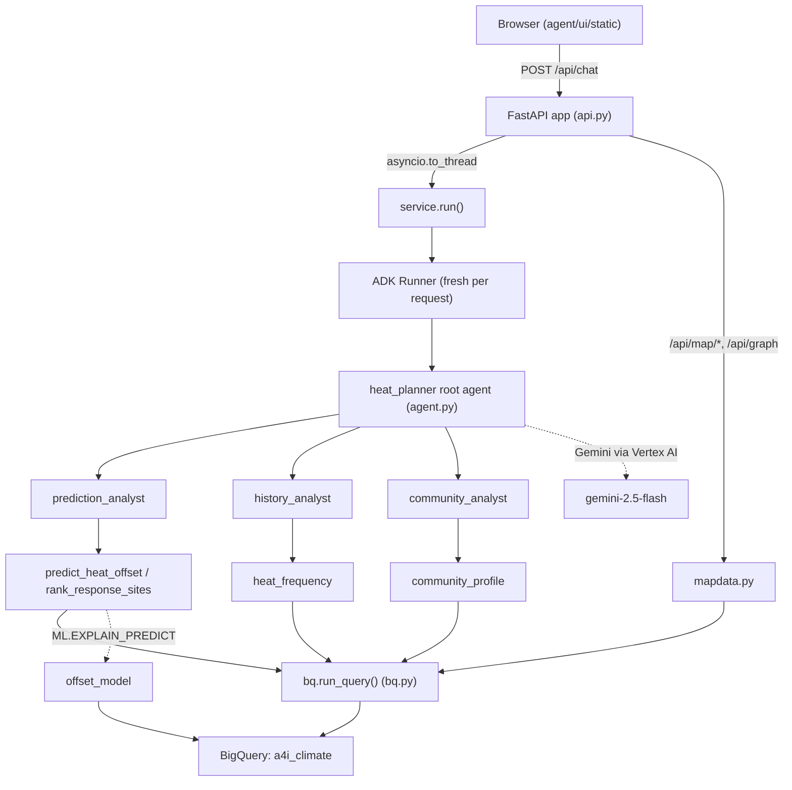

# Architecture

## Overview

A stateless FastAPI service (`agent/heat_planner/api.py`) fronts a Google ADK agent tree. Each
chat request builds a fresh root agent (`heat_planner`) with three specialist sub-agents —
`prediction_analyst`, `history_analyst`, `community_analyst` — each owning a small, disjoint
tool set. Tools query BigQuery through a single safety-wrapped entry point (`bq.run_query()`)
and, for location predictions, call a BigQuery ML model (`offset_model`) via
`ML.EXPLAIN_PREDICT` to get both a number and the features that drove it. A small in-browser
UI (`agent/ui/static/`) talks to the API; a separate map/graph read path (`mapdata.py`) serves
the heat map and tract-relationship graph views.

Source: `docs/architecture.mmd`. Interactive, drill-down version:
[docs/architecture/codebase-walkthrough.html](architecture/codebase-walkthrough.html).

## Layers

| Layer | Files | Responsibility |
|---|---|---|
| API | `agent/heat_planner/api.py` | HTTP surface, request validation, error-to-status mapping |
| Agent tree | `agent/heat_planner/agent.py`, `sub_agents.py`, `callbacks.py`, `context.py`, `prompts.py`, `service.py` | Routing, prompts, per-request state, conversation loop |
| Tools | `agent/heat_planner/tools/` | The agent's four capabilities, each wrapped in `@safe_tool` |
| Data access | `agent/heat_planner/bq.py` | The one place BigQuery is called from |
| Map/graph data | `agent/heat_planner/mapdata.py` | Read-only views for the UI's map and graph tabs, built on the same tools/queries |
| Data pipeline | `notebooks/`, `scripts/load.sh` | Loads NOAA/GHCN/ACS data into BigQuery (out of scope for this agent's code) |

## Statelessness

`service.run()` builds a fresh `AgentContext` and `InMemorySessionService` per chat message —
no server-side session state. The browser resends the full conversation history on every
request (`clean_history()`, capped at `AGENT_HISTORY_TURNS`).

## Deployment

Single container (`agent/Dockerfile`) to Cloud Run, `--min-instances 1` recommended to avoid
a cold start during a live demo. See `.claude/skills/deployment/SKILL.md`.

## Related

- [docs/patterns.md](patterns.md)
- [docs/testing.md](testing.md)
- [docs/adr/](adr/)
- `CLAUDE.md`'s Instruction Map for the governed rules behind each layer
